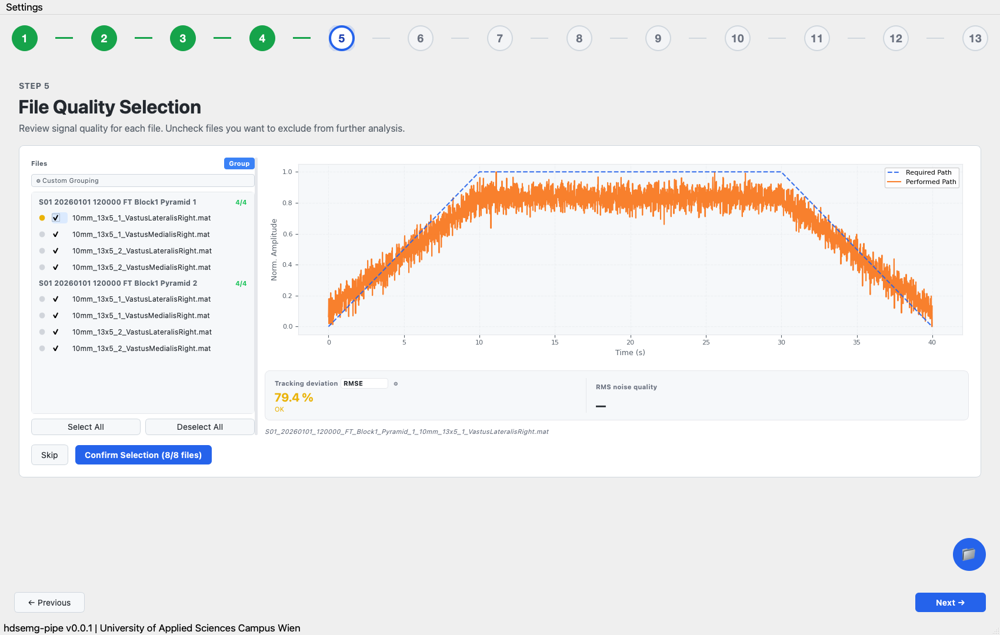

# hdsemg-pipe

This desktop application cleans high-density surface EMG recordings. Users open raw files to perform a thirteen-step process for identifying motor units ready for analysis. The software saves results to individual numbered folders after each step. This permits pausing and resuming the workflow at any stage.

This software requires Python 3.10+ to process `.mat`, `.otb+`, and `.otb4` datasets. For channel selection, use [hdsemg-select](https://github.com/johanneskasser/hdsemg-select). Decomposition is performed via your personal pipeline (scd-edition or MUedit). Motor unit plots are generated using [openhdemg](https://github.com/GiacomoValliPhD/openhdemg).

New here? Install it, then read the workflow page.

- [Installation](installation.md)
- [Workflow](workflow.md)
- [The 13 steps](steps.md)
