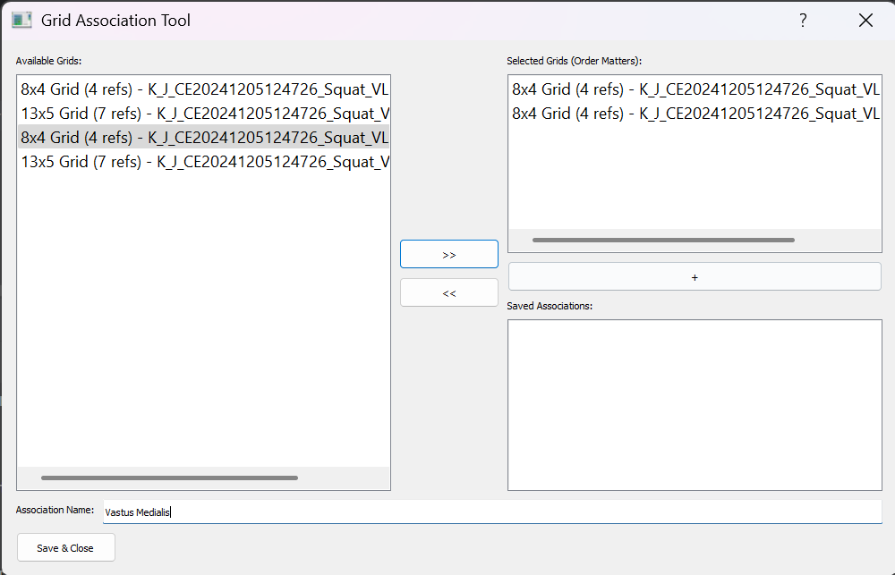
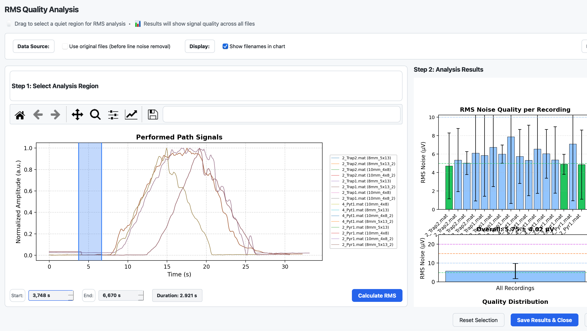
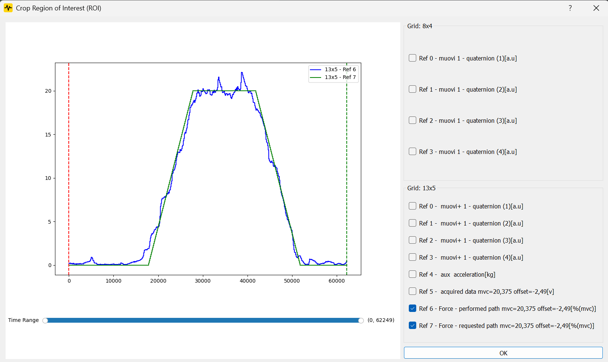
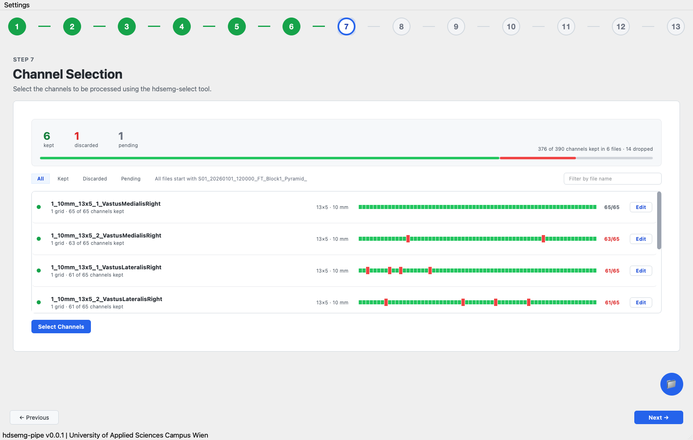
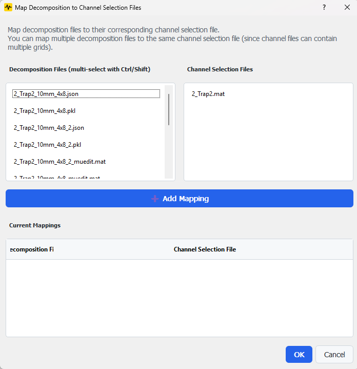
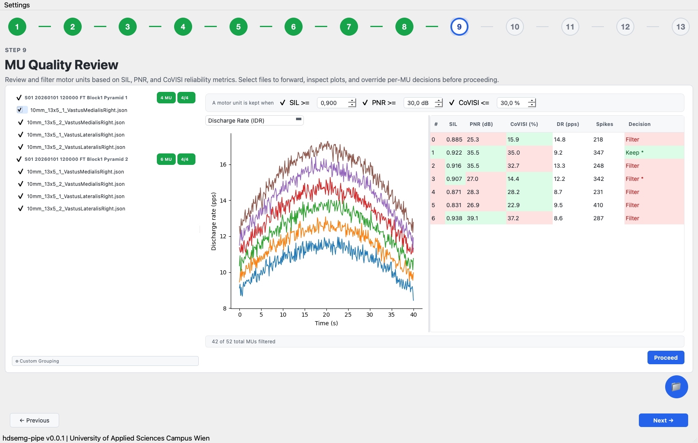
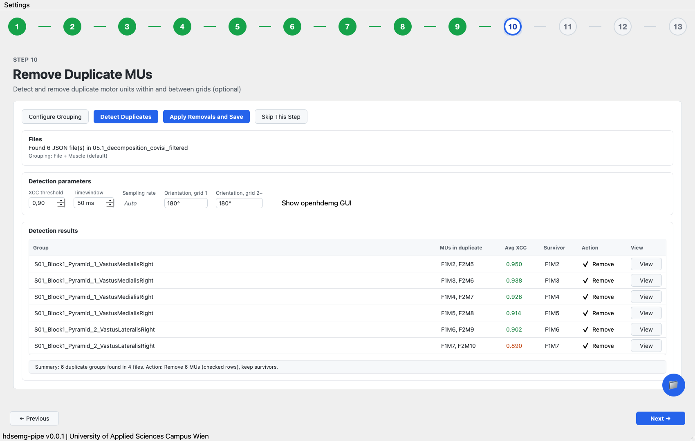
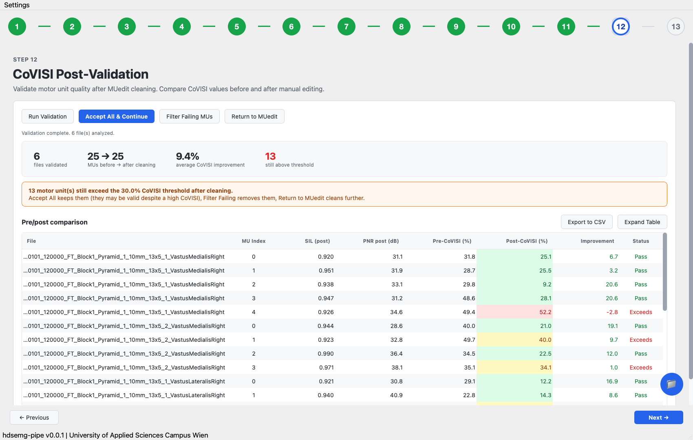

# The 13 steps

## 1. Open files

Pick files or a whole folder. On import the mean is subtracted from every EMG channel and the minimum from the reference signals, so everything sits around zero. A small JSON next to each file records what was subtracted.

## 2. Grid association

Merge grids from several files into one virtual grid. The files need the same time vector and sampling rate. Skipping copies them unchanged.

## 3. Line noise removal

Select a method and a frequency of 50 or 60 Hz. MNE spectrum fit is the default. Alternatively, you may use a MATLAB CleanLine, an MNE notch filter, a MATLAB IIR notch, or an Octave IIR notch, provided those are installed.

## 4. RMS quality analysis

Drag over a stretch of the performed path where the muscle is at rest. The app computes the RMS of every channel and sorts files into bands: up to 5 µV excellent, to 10 good, to 15 OK, to 20 troubled, above that bad. A CSV, a text summary and the figures end up in `07_analysis`.

## 5. File quality selection

Look at required versus performed path for each file, next to its tracking deviation and RMS quality. Untick files you do not want to carry on. Files from the same trial (other grids or muscles) are grouped. The choice is saved as `07_analysis/file_quality_selection.json`, and skipping keeps every file.

## 6. Crop to region of interest

Choose a time range on the reference signals. The same range is cut from every file, and the boundaries are stored in `roi_crop.json` so a wrong crop can be spotted afterwards.

## 7. Channel selection

hdsemg-select opens once per file. When you close it you keep or discard the file and can leave a reason. Discarded files move to a `discarded` folder, the decisions go to `channel_selection_review.json`. Afterwards the step shows every file with a strip of its channels, dropped ones in red. **Edit** reopens a kept file in hdsemg-select. If you stop halfway, the next visit resumes at the first unprocessed file.

## 8. Decomposition results

Perform the decomposition outside of hdsemg-pipe. Place the JSON results in `05_decomposition_auto`. Match every result to its corresponding channel-selection file. The application records the specific route and the received channels for each result.

## 9. MU quality review

Motor units are kept when SIL is at least 0.9, PNR at least 30 dB and CoVISI at most 30 %; all three limits can be changed or switched off. Untick whole files, or click a unit's **Decision** cell to cycle between Auto, Keep and Filter (a star marks manual choices). The plot shows discharge rate, discharge times or MUAPs. **Proceed** writes the filtered files and `07_analysis/mu_quality_selection.json`.

## 10. Remove duplicate MUs

Duplicate units, located in a single grid or across multiple grids of a single muscle, are identified via MUAP cross-correlation (threshold 0.9, window 50 ms). The search accommodates constant offsets between cross-grid pairs. Deselect **Remove** to retain both components of a pair.

## 11. Manual cleaning

Clean the units by hand in MUedit (needs MATLAB) or in scd-edition. The app remembers which one you used.

## 12. CoVISI post-validation

Compares CoVISI before and after cleaning and shows SIL and PNR of the cleaned units. Accept everything, filter the units still above the limit, or go back to the editor. The table can be exported as CSV.

## 13. Final results

The modified files are converted to JSON format within `06_decomposition_results`. Openhdemg opens these files. Then, the [analysis notebooks](analysis.md) are exported.
